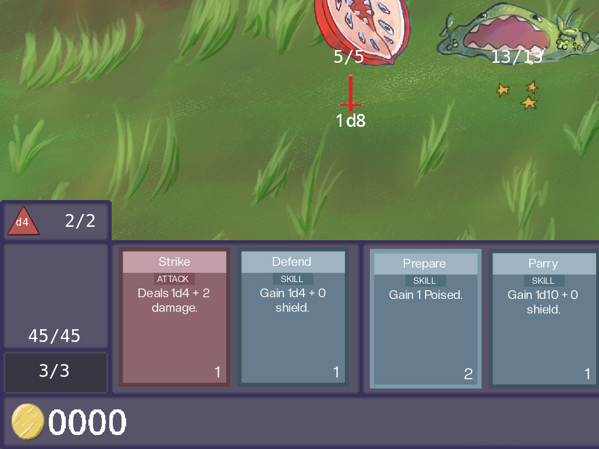
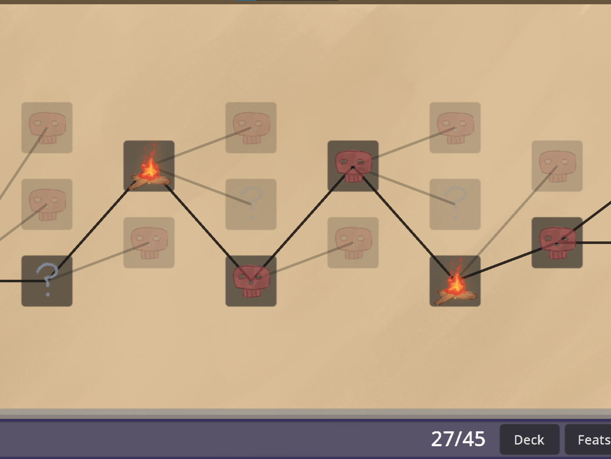
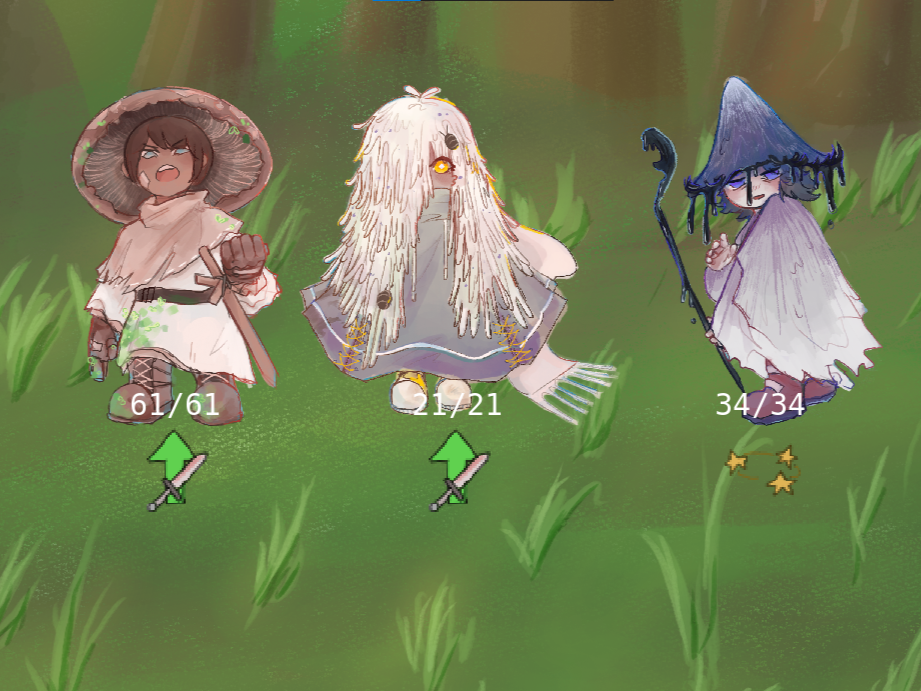

## Persistent Deck System

- Designed and implemented a persistent card system to reduce frustration caused by unfavorable card draws.
- Created a set of weaker, always-accessible cards that provide reliable offensive and defensive options without replacing traditional drawn cards.
- Balanced persistent cards against drawn cards to preserve the importance of deckbuilding while giving players greater control over their turns.

## Procedural Dungeon Generation
- Developed a randomized dungeon generation system featuring enemy encounters, events, rest areas, and elite battles.
- Implemented encounter selection logic to prevent the same enemy or event from appearing twice consecutively.
- Designed weighted encounter probabilities that increase the likelihood of certain encounters, including rest areas and elite fights, when they have not appeared recently.

## Enemy Design
- Designed a diverse roster of 13 enemies, including 6 bosses, with unique abilities, attack patterns, and status effects.
- Implemented reactive enemy AI with weighted decision-making, allowing enemies to change their behavior based on combat conditions.
- Collaborated with artist Yuuki Matsuda to create visually distinct fantasy enemies, incorporating their appearances and identities into their combat mechanics.

